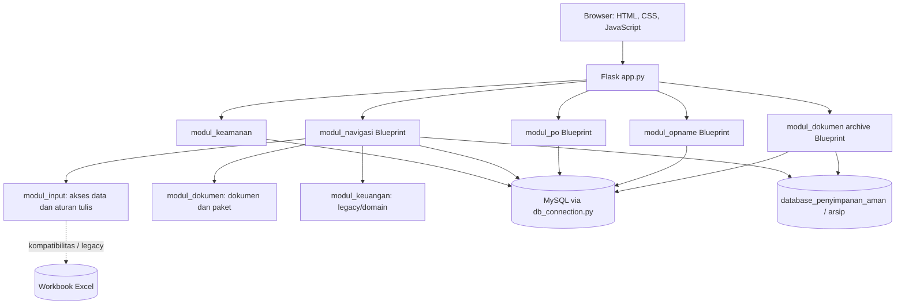
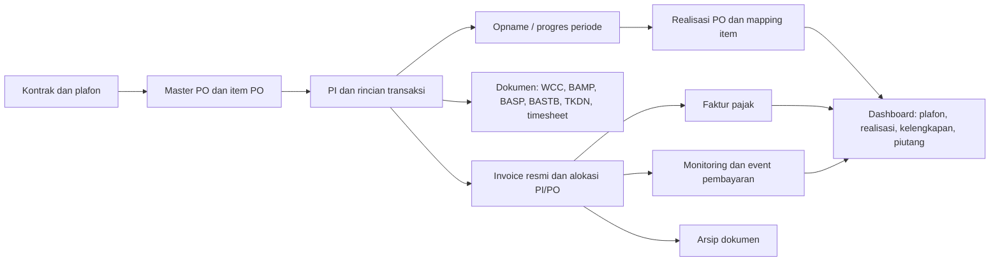
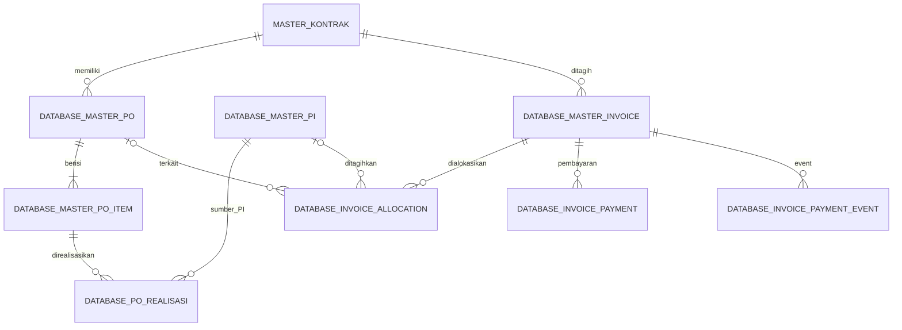

# Dokumentasi Teknis Project Invoice & Operasional BSS

Dokumen ini merangkum implementasi yang terlihat pada repository saat dokumentasi dibuat. Tujuannya memberi programmer atau AI konteks yang cukup untuk memahami aplikasi sebelum mengubahnya.

> **Batas dokumentasi:** repository berisi aplikasi Flask, modul legacy, workbook data lokal, dan migrasi MySQL. Skema aktual server/produksi, isi seluruh workbook, konfigurasi hosting, serta status eksekusi setiap migrasi tidak dapat dipastikan hanya dari source code ini. Keberadaan migration tidak membuktikan migration telah diterapkan.

## 1. Ringkasan

Project ini adalah aplikasi internal untuk mendukung alur kontrak dan pekerjaan, dari master referensi dan Purchase Order (PO), Proforma Invoice (PI), pengukuran progres/Opname, pembuatan dokumen, sampai invoice resmi, pajak, pembayaran, dan arsip.

| Area | Implementasi utama | Penyimpanan dominan |
|---|---|---|
| Web dan autentikasi | Flask, Blueprint, Jinja, session | MySQL untuk user; session Flask |
| Master kontrak/PI/personil | API pada `modul_navigasi/routes.py` | MySQL dan beberapa sumber legacy |
| Master PO dan realisasi | `modul_po/master_po.py` | MySQL |
| Opname dan pemetaan item PO | `modul_opname/` | MySQL |
| Dokumen proyek | `modul_dokumen/` dan API navigasi | MySQL dan file JSON/HTML/workbook |
| Invoice, faktur pajak, monitoring pembayaran | API `modul_navigasi/routes.py`; UI `templates/invoice_tax.html` | MySQL; arsip file di disk |
| Arsip dokumen customer | `modul_dokumen/archive_*` | Metadata/audit MySQL, file di disk, impor metadata Excel |
| Sumber legacy | `modul_input.py`, `modul_input/`, modul keuangan/dokumen | Workbook `.xlsx` |

Aplikasi web aktifnya Flask. Sebagian file lama masih memuat fungsi/layar Streamlit dan dipertahankan sebagai kompatibilitas atau sumber pemindahan fitur.

## 2. Arsitektur aplikasi



### Siklus request

1. Passenger memuat `passenger_wsgi.py`, yang mengimpor `app` dari `app.py`.
2. `create_app()` mengatur Flask, session cookie, `ProxyFix`, Blueprint, route umum, lalu bootstrap Master PO serta arsip dokumen.
3. Bootstrap database bersifat best-effort: kegagalan dicatat dan tidak selalu menghentikan aplikasi. `/health/database` memeriksa koneksi MySQL.
4. Browser menerima halaman Jinja; interaksi selanjutnya umumnya memakai `fetch()` ke API JSON.
5. Endpoint memeriksa session/role, memvalidasi input, menjalankan layanan/query, melakukan commit/rollback, lalu mengembalikan HTML atau JSON.

### Komponen Flask

- `app.py`: application factory, session key, health check, dashboard, template context, response header, error handler, bootstrap.
- `modul_keamanan/routes.py`: login, logout, pengelolaan user.
- `modul_navigasi/routes.py`: halaman aplikasi dan API kontrak/PI, dashboard, dokumen, invoice-tax, dan modul dokumen. File ini besar dan mencakup beberapa domain.
- `modul_po/master_po.py`: Blueprint `/master-po` dan bootstrap skema PO.
- `modul_opname/routes.py`: Blueprint `/opname`.
- `modul_dokumen/archive_routes.py`: Blueprint arsip `/modul/arsip` dan `/api/archive-documents`.

## 3. Alur proses sistem



1. **Master data:** siapkan kontrak, PI, personil, master referensi pekerjaan/harga, dan referensi alat.
2. **Rencana anggaran:** catat PO per kontrak. Header PO memiliki versi/status; item menyimpan kategori, uraian, UOM, kuantitas, harga satuan, plafon. Referensi pekerjaan membantu konsistensi item.
3. **Transaksi dan progres:** PI/rincian transaksi menjadi sumber pekerjaan. Opname membandingkan volume PO, progres lalu, aktual periode, kumulatif dan sisa. Transaksi dipetakan ke item PO; item yang belum terpetakan perlu ditinjau dan jangan dianggap sebagai realisasi mapped.
4. **Dokumen operasional:** paket dokumen menggabungkan konteks kontrak/PO/PI, rincian, tanggal, lokasi, tanda tangan dan konfigurasi. Penyimpanan dapat berupa HTML/JSON/workbook sesuai jenis dokumen.
5. **Penagihan:** pilih sumber kontrak/PI/PO, kalkulasi invoice dilakukan server-side, simpan invoice dan alokasi. Invoice dapat diubah, disalin lewat Save As, atau dibatalkan memakai status.
6. **Pajak dan pembayaran:** simpan referensi faktur pajak, event pembayaran dan monitoring; dashboard menghitung status/aging/piutang.
7. **Arsip:** unggah/indeks dokumen menurut kontrak, kategori dan referensi. Dashboard menyajikan ringkasan anggaran, progres, dokumen dan keuangan.

### Aturan kalkulasi yang tampak di source

- Plafon PO item = kuantitas × harga satuan × faktor kategori. `calculate_po_plafon()` memakai faktor Estimated Sum 0,90; Provisional/Professional Sum 1,15; kategori biasa 1,00.
- API invoice menggunakan `Decimal` dan `ROUND_HALF_UP`; source menjelaskan Professional Sum sebagai At Cost + Management Fee, Estimated Sum sebagai diskon 10% dari gross, PPN 11% bila diaktifkan, serta PPh menurut skema invoice.
- Rumus/tarif merupakan aturan bisnis sensitif. Verifikasi ketentuan terkini sebelum mengubahnya dan pertahankan kalkulasi authoritative pada server.

## 4. Struktur data dan relasi

### Domain inti

| Entitas/tabel | Fungsi |
|---|---|
| `master_kontrak` | Identitas kontrak dan plafon; induk relasi PO, realisasi, invoice, dashboard. |
| `master_kontrak_amendment` | Perubahan/amendment pada model normalisasi. |
| `database_master_po` | Header PO per kontrak/nomor/versi, status dan total plafon. |
| `database_master_po_item` | Item anggaran PO, FK ke header PO, kuantitas, UOM, harga, plafon dan status. |
| `database_po_realisasi` | Realisasi item per PI; relasi bisa eksplisit melalui `po_item_id` atau belum dipetakan. Menyimpan mapping status. |
| `database_po_mapping_rule` | Aturan pemetaan transaksi/rincian ke item PO. |
| `database_master_pi` | Identitas/index PI. Rincian legacy dapat berada pada `database_transaksi_rincian`. |
| `database_master_invoice` | Invoice resmi, nilai dasar/pajak/netto, status dan kontrak. |
| `database_invoice_allocation` | Alokasi invoice ke PI dan PO; dapat ada beberapa alokasi per invoice. |
| `database_invoice_payment` | Ringkasan monitoring pembayaran per invoice. |
| `database_invoice_payment_event` | Riwayat event pembayaran; migration 005 menambah soft-delete. |
| `database_tax_invoice_reference` | Referensi faktur pajak yang terkait invoice/kontrak. |
| `database_invoice_document_archive` | Arsip invoice-tax pada mekanisme yang lebih lama. |
| `database_document_archive` | Metadata arsip dokumen pusat yang lebih baru. |
| `database_document_archive_audit` | Audit aksi arsip pusat. |
| `database_users` | User aplikasi, hash password, role/departemen, status aktif. |
| `database_master_personil` | Master orang/jabatan yang dipakai ulang. |
| `database_master_referensi` | Kategori, uraian, UOM dan harga referensi. |
| `database_opname` | Snapshot Opname; detail kolom bergantung bootstrap/schema aktual. |

Model relasi yang diharapkan:



Diagram menggambarkan rancangan dan penggunaan kode/migrasi; sebagian FK nullable dan data lama dapat hanya terhubung melalui nomor teks. Database aktual mungkin belum sepenuhnya ternormalisasi.

Tabel lain di source/migration meliputi `database_master_nama_alat`, `database_opname_parameter`, `database_tkdn`/`database_tkdn_tersimpan`, `database_timesheet_history`, `database_billing_tax`, `database_status_pembayaran`, `database_faktur_pajak_online`, `database_npwp_customer`, `database_plafon_kontrak`, `database_migration_log`, `database_invoice_tax_audit`, `database_invoice_tax_audit_log`, dan `database_document_archive_migration`. Nama tabel tidak selalu berarti tabel MySQL aktif: sebagian adalah workbook legacy atau alias kompatibilitas.

### Workbook legacy yang ditemukan

Header berikut berasal dari workbook lokal yang tersedia dan bukan jaminan semua salinan produksi sama.

| Workbook di `database_penyimpanan_aman/` | Data utama |
|---|---|
| `database_proforma_invoice.xlsx` | PI, kontrak/tender/PO, pihak, tanggal, ruang lingkup, WCC/WO/CTR dan penandatangan. |
| `database_transaksi_rincian.xlsx` | Transaksi/rincian item, qty, harga, bank; memiliki kolom bentuk legacy dan normalisasi. |
| `database_master_po.xlsx` | Kontrak/PO, kategori, uraian, UOM, volume, harga satuan, total plafon. |
| `database_master_referensi.xlsx` | Kontrak, kategori, uraian, unit dan harga satuan. |
| `database_proforma_invoice_tersimpan.xlsx`, `database_rincian_pekerjaan_tersimpan.xlsx` | Snapshot rincian PI/pekerjaan, periode, qty, harga, persen dan catatan. |
| `database_opname_parameter.xlsx` | Parameter/payload Opname, item, kontrak/PI/PO, tanggal, volume dan harga. |
| `database_billing_tax.xlsx` | Invoice legacy, customer/NPWP, pajak dan komponen Professional/Estimated Sum. |
| `database_status_pembayaran.xlsx` | Tanggal, TOP, nominal tagihan/aktual, potongan, selisih, status dan catatan. |
| `database_faktur_pajak_online.xlsx` | Invoice, NSFP, tanggal, DPP, customer, NPWP dan keterangan. |
| `database_users.xlsx`, `database_pengguna.xlsx` | User legacy; workbook password bukan sumber autentikasi runtime yang semestinya. |
| `database_bamp_tersimpan.xlsx`, `database_basp_tersimpan.xlsx`, `database_bastb_tersimpan.xlsx` | Data dokumen pendukung sesuai jenisnya. |
| `database_tkdn_tersimpan.xlsx`, `database_tkdn_history.xlsx` | Input/hasil TKDN dan histori. |
| `database_timesheet_history.xlsx`, `database_wcc_tersimpan.xlsx` | Histori timesheet dan WCC. |
| `database_npwp_customer.xlsx`, `database_plafon_kontrak.xlsx`, `database_master_nama_alat.xlsx` | Referensi customer, plafon, alat. |

## 5. Database, koneksi, migrasi

### Koneksi dan environment

`db_connection.py` menggunakan `mysql-connector-python` dan connection pool lazy.

| Variable | Fungsi |
|---|---|
| `DB_HOST`, `DB_NAME`, `DB_USER`, `DB_PASSWORD` | Koneksi MySQL wajib. |
| `DB_PORT` | Port MySQL; default 3306. |
| `DB_POOL_SIZE` | Ukuran pool; default 6. |
| `DB_POOL_RESET_SESSION` | Opsi reset sesi; default false. |
| `SECRET_KEY` | Secret Flask; bila kosong gunakan/buat file persisten. |
| `SECRET_KEY_FILE` | Lokasi alternatif file secret. |
| `LOG_LEVEL` | Tingkat log; default INFO. |

`get_db_connection()` mengambil koneksi pool, ping/reconnect, melakukan rollback best-effort pada cleanup, lalu mengembalikan koneksi. Perubahan data harus memakai transaksi eksplisit `commit()`/`rollback()`. Helper generik di `db_connection.py` mengecek metadata tabel/kolom sebelum upsert; nama tabel tidak boleh berasal dari input user.

### Migrasi SQL

| Migration | Lingkup |
|---|---|
| `001_normalisasi_kontrak_po_keuangan.sql` | Master kontrak/amendment, relasi kontrak–PO–PI–invoice, alokasi, pembayaran dan view ringkasan. |
| `002_invoice_tax_step1_data_quality.sql` | Data-quality/indeks invoice, referensi faktur pajak dan audit. |
| `003_invoice_tax_archive_audit.sql` | Arsip dokumen dan audit khusus invoice-tax. |
| `004_invoice_payment_history.sql` | Event/riwayat pembayaran. |
| `005_payment_event_soft_delete.sql` | Penanda soft-delete event pembayaran. |
| `006_central_document_archive.sql` | Arsip pusat, audit, dan registry impor legacy. |
| `007_rekonsiliasi_data_excel_dengan_mysql_2026_10_17.sql` | Rekonsiliasi Excel/MySQL; baca review companion sebelum menjalankan. |

Master PO dan arsip pusat juga membuat/memperbarui skema melalui bootstrap aplikasi. Skema dapat berasal dari migrasi manual, bootstrap dan penyesuaian runtime. Periksa `SHOW CREATE TABLE` di target sebelum menjalankan DDL atau menambah kolom. Migration 007 dapat berdampak pada data: tinjau SQL, backup, uji pada staging/salinan, simpan hasil rekonsiliasi.

## 6. Route dan API penting

Halaman internal kecuali health/login memerlukan autentikasi sesuai decorator endpoint.

### Sistem umum

| Method/path | Fungsi |
|---|---|
| `GET /` | Arahkan ke login atau dashboard. |
| `GET /health` | Health Flask tanpa MySQL. |
| `GET /health/database` | Health koneksi MySQL. |
| `GET/POST /login`, `GET /logout` | Autentikasi. |
| `GET /dashboard` | Dashboard/halaman modul. |

### PO dan Opname

- `/master-po/`: UI Master PO. API di `/master-po/api*` untuk daftar, analytics, kontrak, opsi referensi, detail, histori, mapping tertunda, registrasi dari histori, dampak hapus, create/update/delete.
- `/opname/`: UI Opname. API: `/opname/api/pi`, `/po`, `/context`, `/po/mapping-options`, `/po/reconcile`, `/po/add-pi-item`, `/save`.

### Kontrak, PI, personil, dashboard

UI: `/modul/database-kontrak`, `/master/personil`. API: `/api/modul-1/contracts`, `/pi`, `/pi/detail`, `/pi/update`, `/pi/save-as`, `/pi/delete`, `/contract/update`, `/contract/impact`, `/persons`, serta endpoint dashboard analytics dan kesiapan dokumen.

### Invoice, pajak, pembayaran

Halaman `/modul/invoice-tax`; semua API berikut berada di prefix `/api/modul-3`:

- `GET /invoice-sources`; `POST /invoices/calculate`.
- `GET/POST /invoices`; `GET/PUT/PATCH/DELETE /invoices/<id>`; `POST /invoices/<id>/save-as`.
- `GET/POST /tax-references`; `DELETE /tax-references/<id>`.
- `GET/POST /payment-monitoring`; `GET/POST /payment-events`; `DELETE /payment-events/<id>`.
- `GET/POST /archives`; `GET /archives/<id>/download`; `DELETE /archives/<id>`; `GET /audit-log`.
- Dokumen: `/modul/invoice-tax/invoice/<id>` dan `/modul/invoice-tax/receipt/<id>`.

### Arsip pusat dan dokumen proyek

- Halaman arsip pusat `/modul/arsip`; API `GET/POST /api/archive-documents`, `GET /<id>/download`, `GET /<id>/preview`, `DELETE /<id>` di bawah prefix tersebut.
- Kategori: PO, PI, CTR, WO, WAN, timesheet, surat jalan, berita acara lapangan, korespondensi, invoice resmi dan dokumen pajak. Batas file 25 MiB dan ekstensi allowlist ada di `modul_dokumen/archive_service.py`; kategori privat mempunyai pembatasan role.
- Endpoint `/api/modul-2/...` pada `modul_navigasi/routes.py` melayani dokumen, editor TKDN serta konfigurasi/status paket.

## 7. Autentikasi dan akses

- `modul_keamanan/decorators.py` menyediakan `login_required`; aturan tulis digunakan dari `modul_input/modul_1_database.py` melalui `can_write()`.
- Session memuat `logged_in`, `current_user`, `current_role`, `nama_lengkap`. Cookie: `HttpOnly`, `Secure`, `SameSite=Lax`.
- Password user baru di-hash oleh layanan auth; user tersimpan di MySQL `database_users`.
- Role yang ditangani `app.py`: management/direksi, finance & tax, project manager, project support, admin support, super admin/admin. Endpoint tertentu memiliki allowlist khusus; permission dashboard bukan satu-satunya kontrol.
- Jangan menyimpan credential di source/log/dokumentasi. `instance/session_secret_key` adalah secret lokal dan di-ignore Git.
- Endpoint baru harus menerapkan autentikasi, otorisasi baca/tulis, validasi, query berparameter, dan audit untuk operasi finansial/dokumen sensitif.

## 8. Peta struktur repository

```text
.
├── app.py                         # Factory Flask, route umum, bootstrap, headers
├── passenger_wsgi.py              # Entry point Passenger/cPanel
├── db_connection.py               # Pool MySQL dan helper baca/upsert
├── invoice_documents.py           # Context/render invoice dan kuitansi
├── modul_input.py                 # UI/adapter input legacy
├── modul_invoice.py               # Entry legacy
├── modul_master.py                # Helper master referensi legacy
├── modul_rekap_po_PO.py           # Rekap PO legacy
├── modul_keamanan/                # Auth, user service, decorator
├── modul_navigasi/                # Route bisnis/dashboard dan master bank JSON
├── modul_input/                   # Referensi, kontrak, personil, rincian
├── modul_po/                      # Master PO, UI, aturan bisnis
├── modul_opname/                  # Route/service/mapping dan template Opname
├── modul_dokumen/                 # Generator dokumen, paket, tanda tangan, arsip
├── modul_keuangan/                # Domain/implementasi legacy finansial
├── templates/                     # Jinja UI dan dokumen cetak
├── static/                        # CSS dan JavaScript
├── migrations/                    # DDL/transformasi MySQL dan review
├── docs/                          # Dokumentasi/rencana
├── database_penyimpanan_aman/     # Workbook dan file data/runtime
└── requirements.txt               # Flask, Werkzeug, mysql-connector-python, openpyxl
```

Folder `database_penyimpanan_aman/` berisi workbook, HTML paket, konfigurasi logo, arsip customer dan JSON WCC/TKDN. Itu data runtime, bukan source code; jangan dibersihkan, ditimpa atau di-commit tanpa backup dan prosedur pemilik data. `tmp/`, `instance/`, dan log juga memuat artefak runtime.

Template penting: `templates/layout/` untuk layout/sidebar; `dashboard*.html`; `modul_0_referensi.html`, `modul_1_database.html`, `modul_1_master_personil.html`, `modul_2.html`; `invoice_tax.html`, `invoice_official.html`, `invoice_receipt.html`; `archive_documents.html`, `archive_preview.html`; `tkdn_editor.html`. Asset arsip ada di `static/js/archive-documents.js`, CSS di `static/css/`.

## 9. Pengembangan dan operasi

1. Siapkan Python dan dependensi dari `requirements.txt` (saat ini tidak mematok versi).
2. Siapkan MySQL dan environment `DB_HOST`, `DB_PORT`, `DB_NAME`, `DB_USER`, `DB_PASSWORD`, `SECRET_KEY`. Jangan gunakan database produksi untuk eksperimen.
3. Review skema dan migration yang diperlukan untuk checkout ini. Backup sebelum DDL/perubahan data.
4. Entry point Passenger adalah `passenger_wsgi.py`; restart diperlukan sesudah deploy perubahan Python/config.
5. Verifikasi `/health`, kemudian `/health/database`, login dan alur fitur yang berubah.
6. `create_admin.py` adalah utilitas setup user; tinjau kode dan target database sebelum menjalankan.

Tidak ada konfigurasi dev server lokal yang eksplisit dalam repository ini, jadi command lokal perlu disepakati sebelum dicatat sebagai workflow resmi.

## 10. Panduan perubahan

1. Telusuri route, template, service, dan query terkait; route navigasi sangat besar, gunakan pencarian simbol untuk mempersempit.
2. Pastikan sumber authoritative untuk fitur: MySQL normalized, tabel legacy, atau workbook. Prefix `database_*` tidak selalu berarti MySQL.
3. Gunakan placeholder SQL, transaksi, FK/indeks yang sesuai, dan bentuk error konsisten. Jangan log data pajak, password atau dokumen.
4. Perubahan skema harus memiliki migration bernomor, precondition, prosedur backup/rollback dan catatan rekonsiliasi.
5. Untuk PO/Opname jaga normalisasi kategori/UOM/uraian, versi PO, status mapping dan proteksi realisasi saat mengubah item.
6. Untuk invoice jaga kalkulasi server-side, audit, alokasi, pembatalan berbasis status dan kaitan pembayaran.
7. Untuk upload gunakan allowlist, batas ukuran, nama penyimpanan acak, validasi role dan sanitasi path.
8. Perbarui dokumentasi ini jika alur, API, skema, format simpan atau deployment berubah.

## 11. Catatan dan batas pengetahuan

- `docs/INVOICE_TAX_MIGRATION_PLAN.md` memiliki beberapa status yang tertinggal. Source `modul_navigasi/routes.py` dan UI invoice-tax sudah memiliki banyak endpoint yang di dokumen tersebut masih ditulis belum ada. Gunakan kode untuk perilaku aktif, rencana sebagai riwayat/arah.
- Ada dua mekanisme arsip: arsip invoice-tax (`database_invoice_document_archive`, `/api/modul-3/archives`) dan arsip pusat (`database_document_archive`, `/api/archive-documents`). Jangan satukan tanpa migrasi dan review akses.
- Ada beberapa workbook/user legacy. Runtime auth memakai layanan MySQL; workbook user bukan acuan autentikasi.
- Migration, bootstrap aplikasi dan workbook dapat menggambarkan versi skema berbeda. Periksa schema target aktual sebelum deployment.
- `modul_keuangan/` berisi modul/domain legacy; UI Flask invoice-tax aktif dirender terutama dari `templates/invoice_tax.html` dan handler di `modul_navigasi/routes.py`.
- Dokumentasi ini tidak menyalin data customer, nomor pajak, rekening, atau credential.

## 12. Bacaan utama saat mulai bekerja

- Bootstrap/runtime: `app.py`, `passenger_wsgi.py`.
- Database: `db_connection.py`.
- Auth/role: `modul_keamanan/routes.py`, `auth_service.py`, `decorators.py`, `modul_input/modul_1_database.py`.
- Kontrak, PI, dashboard, invoice-tax: `modul_navigasi/routes.py`.
- Master PO: `modul_po/master_po.py`.
- Opname: `modul_opname/routes.py`, `services.py`, `po_mapping.py`.
- Dokumen/paket: `modul_dokumen/document_package_service.py`, `document_engine.py`, `document_package_renderer.py` dan handler `/api/modul-2`.
- Arsip pusat: `modul_dokumen/archive_service.py`, `archive_routes.py`.
- Skema target: `migrations/*.sql` dan bootstrap pada `modul_po/master_po.py`, `modul_navigasi/routes.py`, `modul_dokumen/archive_service.py`.
- Rencana migrasi invoice: `docs/INVOICE_TAX_MIGRATION_PLAN.md` (catatan historis yang dapat stale).

---

**Status:** Dokumentasi inspeksi repository lokal, bukan sertifikasi skema produksi atau audit keamanan. Perbarui setelah source atau migration berubah.
